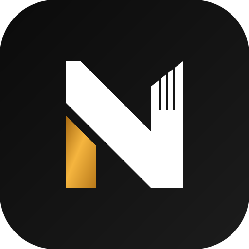

<p align="center"></p>

# NEXAL

An automated trading bot that monitors Telegram and Discord channels for trading signals and executes them via MetaAPI or a self-hosted MT5 bridge, with AI-powered analysis, risk management, and position monitoring.

> Trading involves substantial risk. This software is provided as is, without warranty (see [LICENSE](LICENSE)); test with a demo account or dry run first.

## ✨ Features

- 📱 **Telegram Signal Detection**: Automatically extracts trading signals from Telegram channels
- 🎮 **Discord Signal Detection**: Listens to the server channels you select in the dashboard
- 🤖 **AI-Powered Analysis**: Multiple AI providers (OpenAI, DeepSeek, Ollama) for signal validation
- 📰 **Economic News Filter**: Blocks trading during high-impact news events
- 🛡️ **Advanced Risk Management**: Position sizing, stop-loss, take-profit automation
- 📊 **Real-time Position Monitoring**: Auto-adjust SL/TP based on market conditions
- 💾 **Database Tracking**: Complete trade history with Prisma ORM
- 📈 **Web Dashboard**: Next.js dashboard for monitoring trades and analytics
- 🐳 **Docker Support**: Easy deployment with docker-compose

## 🚀 Quick Start with Docker (Recommended)

The fastest way to get started is using Docker, which handles all dependencies and ensures the bot and dashboard share the same database.

### Prerequisites

- A Linux server with [Docker](https://docs.docker.com/get-docker/) and the Compose plugin
- A free [Clerk](https://dashboard.clerk.com) application (dashboard login)
- A trading connection: a [MetaAPI](https://metaapi.cloud) account, or the self-hosted MT5 bridge in `mt5/`
- An AI API key (DeepSeek, OpenAI, or a local Ollama)
- Optional: Telegram API credentials ([my.telegram.org](https://my.telegram.org)); Discord is set up in the dashboard

### Setup

```bash
git clone <repository-url> nexal && cd nexal
./deploy.sh --init
```

The wizard creates `.env`, generates the encryption key, starts the MT5 bridge first if you use it,
asks for the credentials, creates the database and starts everything. Afterwards:

- Dashboard: http://localhost:3000 on the server (SSH tunnel or reverse proxy from elsewhere)
- Sign up, then put your Clerk user id into `.env` as `AUTHORIZED_USER_ID` and run `docker compose up -d dashboard`
- Log in to Telegram under **Connections**, pick channels, review the risk settings

**Installing with an AI agent, or want every step spelled out?** See [AGENTS.md](AGENTS.md).

### Everyday commands

```bash
./deploy.sh                          # update: build, back up the database, migrate, restart
docker compose logs -f trading-bot   # live log
docker compose stop                  # stop (keeps the database)
scripts/rollback.sh                  # back to the previous version
```

Never run `docker compose down -v`: it deletes the database.

## 🛠️ Manual Installation (Alternative)

If you prefer to run without Docker:

### Prerequisites

- Python 3.11+
- Node.js 20+
- SQLite (or PostgreSQL for production)

### Setup

1. **Install Python dependencies**
   ```bash
   pip install -r requirements.txt
   ```

2. **Setup database**
   ```bash
   prisma generate
   prisma migrate deploy
   ```

3. **Install dashboard dependencies**
   ```bash
   cd dashboard
   npm install
   cd ..
   ```

4. **Configure environment**
   ```bash
   cp .env.example .env
   # Edit .env with your credentials
   ```

5. **Run the bot**
   ```bash
   python main.py
   ```

6. **Run the dashboard** (in a separate terminal)
   ```bash
   cd dashboard
   npm run dev
   ```

## 📊 Architecture

### Database Sharing (Docker)

```
┌──────────────┐         ┌─────────────┐
│ Trading Bot  │────────▶│   Docker    │◀────────┤  Dashboard  │
│   (Python)   │         │   Volume    │         │  (Next.js)  │
└──────────────┘         └─────────────┘         └─────────────┘
                           trading_bot.db
                         (Shared SQLite)
```

**Key Feature**: Both the bot and dashboard access the same database file through a Docker volume, ensuring real-time data synchronization without any lag.

### Components

- **Main Bot** (`main.py`): Orchestrates all components
- **Telegram Listener**: Monitors channels for signals
- **AI Processors**: Validates and analyzes signals
- **MetaAPI Trader**: Executes trades on broker
- **Position Monitor**: Manages active trades (trailing SL, auto-TP)
- **Risk Manager**: Enforces risk limits and drawdown protection
- **Database Service**: Tracks all trades and analytics
- **Dashboard**: Web UI for monitoring and control

## 🎯 Key Features Explained

### 1. AI Signal Validation

Supports multiple AI providers with automatic fallback:
- **OpenAI GPT-4**: High accuracy, paid
- **DeepSeek**: Cost-effective alternative
- **Ollama**: Free local AI (Llama2, Mistral)

### 2. Economic News Filter

Automatically fetches economic calendar and blocks trading:
- 10 minutes before high-impact news
- 5 minutes after news release
- Configurable currencies and impact levels

### 3. Advanced Position Management

- **Auto Take Profit**: Calculate TP based on risk-reward ratio
- **Trailing Stop Loss**: Lock in profits as price moves favorably
- **Breakeven Move**: Move SL to entry after profit threshold
- **Auto Partial**: Take partial profits at predetermined levels

### 4. Risk Management

- **Per-trade risk**: Max 2% of account per trade
- **Daily drawdown limit**: Stop trading after 6% daily loss
- **Overall drawdown protection**: Close all positions at 10% loss
- **Position size calculator**: Automatically calculates lot size

### 5. Database Tracking

Complete audit trail using Prisma ORM:
- All signals received
- Trade executions and modifications
- Position updates and closures
- System events and errors

## 📂 Project Structure

```
telegram-trading-bot/
├── main.py                      # Main entry point
├── config/                      # Configuration
│   └── settings.py
├── src/
│   ├── core/                    # Database and Prisma client
│   ├── integrations/
│   │   ├── telegram/           # Telegram listener/sender
│   │   └── metaapi/            # MetaAPI trader
│   ├── services/               # Business logic
│   │   ├── trading_service.py
│   │   ├── risk_service.py
│   │   ├── position_monitor_service.py
│   │   └── ...
│   └── models/                 # Data models
├── ai/                         # AI processors
│   ├── openai_processor.py
│   ├── deepseek_processor.py
│   └── ollama_processor.py
├── prisma/                     # Database schema
│   └── schema.prisma
├── dashboard/                  # Next.js dashboard
│   ├── src/
│   ├── prisma/                # Dashboard uses same schema
│   └── Dockerfile
├── docker-compose.yml          # Docker orchestration
├── Dockerfile                  # Bot container
└── docs/                       # Detailed documentation
```

## 🔧 Configuration

Key environment variables in `.env`:

### Telegram
```env
TELEGRAM_API_ID=your_api_id
TELEGRAM_API_HASH=your_api_hash
TELEGRAM_PHONE=+1234567890
TELEGRAM_CHANNEL_ID=@your_channel
```

### MetaAPI
```env
METAAPI_TOKEN=your_token
METAAPI_ACCOUNT_ID=your_account_id
```

### AI Provider
```env
PRIMARY_AI_PROVIDER=openai
OPENAI_API_KEY=your_key
```

### Risk Management
```env
MAX_RISK_PER_TRADE_PERCENT=2.0
MAX_OPEN_POSITIONS=5
```

### Database
```env
DATABASE_URL="file:./trading_bot.db"
# Docker will override this automatically
```

For complete configuration options, see `.env.example`.

## 🔀 Runtime control & operations

- **Switch MetaAPI ↔ MT5 REST without a restart** (different accounts, one active at a time, no fallback), live settings reload:
  see [docs/RUNTIME_SETTINGS.md](docs/RUNTIME_SETTINGS.md).
- **MetaAPI reads are streamed** (live positions/orders/account, no API-call limits); disable with
  `METAAPI_USE_STREAMING=false`.
- **Audit trail:** provider switches, settings changes (secrets masked), stream loss and ERROR logs are
  stored in the `system_events` table.
- **Before trading live:** run through [docs/DEMO_RUN_CHECKLIST.md](docs/DEMO_RUN_CHECKLIST.md) on a demo account.

## 📖 Documentation

- [Docker Setup Guide](DOCKER_SETUP.md) - Comprehensive Docker documentation
- [Docker Quick Reference](DOCKER_QUICK_REFERENCE.md) - Command cheat sheet
- [AI Features Guide](docs/AI_FEATURES_QUICK_START.md) - AI configuration
- [Database Integration](docs/AI_ANALYSIS_DATABASE_INTEGRATION.md) - Database schema
- [Risk Management](docs/RISK_MANAGEMENT.md) - Risk settings

## 🚨 Important Notes

### Database with Docker

When using Docker:
- ✅ Both bot and dashboard **automatically share the same database**
- ✅ No configuration needed - it just works
- ✅ Database persists in Docker volume even after restart
- ✅ Real-time updates: bot writes → dashboard reads instantly

### Database without Docker

If running manually:
- ⚠️ Ensure both bot and dashboard point to the same `.db` file
- ⚠️ Set `DATABASE_URL="file:./trading_bot.db"` in root `.env`
- ⚠️ Set `DATABASE_URL="file:../trading_bot.db"` in `dashboard/.env.local`

### Production Considerations

- **Use PostgreSQL** for production instead of SQLite
- **Enable all risk protections** in `.env`
- **Test thoroughly** in demo account first
- **Monitor drawdown limits** closely
- **Regular database backups**

## 🐞 Troubleshooting

### Dashboard shows no data

**Docker**:
```bash
# Verify both containers use same volume
docker volume inspect trading-bot-database
docker-compose exec trading-bot ls -la /app/data/
docker-compose exec dashboard ls -la /app/data/
```

**Manual**:
- Check DATABASE_URL in both `.env` and `dashboard/.env.local`
- Ensure paths point to same file

### Telegram authentication issues

**Docker**:
```bash
# Check logs
docker-compose logs -f trading-bot

# Session is persisted in volume automatically
```

**Manual**:
- Delete `.telethon/*.session` files
- Restart bot and re-authenticate

### Database locked errors

SQLite doesn't handle high concurrent writes:
1. Reduce `POSITION_MONITOR_INTERVAL_SECONDS` in `.env`
2. Or upgrade to PostgreSQL

## 🤝 Contributing

Contributions welcome! Please:
1. Fork the repository
2. Create a feature branch
3. Test thoroughly (especially with Docker)
4. Submit a pull request

## ⚖️ License

[MIT](LICENSE)

## ⚠️ Disclaimer

This bot is for educational purposes. Trading involves risk. Always test thoroughly with a demo account before using real money. The authors are not responsible for any financial losses.

## 🔗 Links

- [MetaAPI Documentation](https://metaapi.cloud/docs/)
- [Telegram API](https://core.telegram.org/api)
- [Prisma ORM](https://www.prisma.io/)
- [Next.js](https://nextjs.org/)
- [Docker Documentation](https://docs.docker.com/)

## 📞 Support

For issues or questions:
1. Check [DOCKER_SETUP.md](DOCKER_SETUP.md) for Docker-specific issues
2. Check logs: `docker-compose logs -f` or `./logs/`
3. Review `docs/` folder for detailed guides
4. Open an issue on GitHub

---

**Made with ❤️ for automated trading**
